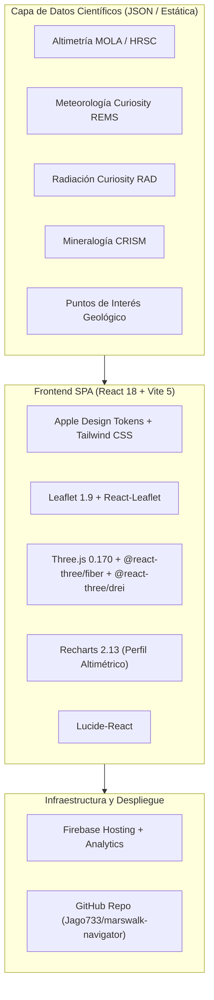

# 🤖 AI Context & System Architecture: MarsWalk Navigator

> [!NOTE]
> Este archivo está optimizado para que modelos y agentes de IA (LLMs) adquieran contexto instantáneo sobre el estado, arquitectura, datasets, lógica algorítmica y lineamientos de diseño de **MarsWalk Navigator**.

---

## 1. Resumen Ejecutivo y Alcance del Problema

### Consigna Oficial de la NASA
La primera tripulación humana en Marte realizará paseos espaciales (**Marswalks / EVA**) para conducir ciencia que los robots no pueden realizar autónomamente. Los astronautas requieren una interfaz táctica e integrada que una múltiples misiones científicas de la NASA para planificar y ejecutar rutas de superficie de forma rápida, segura y geológicamente valiosa.

### Solución Desarrollada
**MarsWalk Navigator** es una Single-Page Application (SPA) en React + Vite que proporciona navegación GPS y análisis de terreno desde un **Punto A** hasta un **Punto B** en el **Cráter Gale y el Monte Sharp (Aeolis Mons)**.

### Restricciones de Dominio Clave
1. **Idioma Estricto:** Toda la interfaz de usuario, métricas, avisos y glosarios están al **100% en Español (`es-ES`)**.
2. **Filosofía 3D Ligera:** **NO se renderiza una esfera planetaria completa ni gigabytes de teselas 3D.** En su lugar, Three.js modela proceduralmente **el corredor y corte de elevación vertical de la ruta** (*Bedrock Curtain* y tubería de gradiente), logrando rendimiento de 60 FPS en cualquier navegador.
3. **Seguridad Biomecánica:**
   - Pendiente segura: $\le 12^\circ$
   - Pendiente moderada: $12^\circ - 20^\circ$
   - Pendiente peligrosa: $20^\circ - 25^\circ$
   - **Barrera infranqueable sin anclaje:** $> 25^\circ$ (límite del traje espacial presurizado).
4. **Soporte Vital (PLSS):** 6 horas nominales de EVA, 2 horas de contingencia obligatoria (8 horas totales de $O_2$).

---

## 2. Pila Tecnológica (Tech Stack)



* **Framework:** React 18.3, Vite 5.4
* **Estilos:** Tailwind CSS 3.4, Lucide React
* **Motor Cartográfico 2D:** Leaflet 1.9, React-Leaflet 4.2
* **Motor Gráfico 3D:** Three.js 0.170, React Three Fiber 8.17, React Three Drei 9.117
* **Visualización de Datos:** Recharts 2.13
* **Backend:** Serverless / Frontend estático alojado en Firebase Hosting
* **SDK Cloud:** Firebase 11.0 (App & Analytics)

---

## 3. Estructura de Directorios y Archivos

```
c:\Users\JORGE GRAGEDA\Documents\ABDY\Nasa space apps 2\
├── .firebaserc                     # Configuración del proyecto Firebase (marswalk-navigator)
├── .gitignore                      # Reglas de exclusión Git
├── AI_CONTEXT.md                   # Este archivo (contexto integral para agentes IA)
├── firebase.json                   # Reglas de despliegue en Firebase Hosting (dist -> index.html)
├── index.html                      # HTML5 raíz, Leaflet CSS, fuentes Inter y SF Pro
├── package.json                    # Dependencias y scripts
├── README.md                       # Documentación orientada al usuario y jurados
├── tailwind.config.js              # Tokens de color Apple + Mars, radios pastilla y sombras
├── vite.config.js                  # Configuración de compilación Vite
│
├── public/
│   ├── favicon.svg                 # Isotipo vectorial de Marte + órbita
│   └── data/                       # Datasets científicos NASA pre-procesados
│       ├── curiosity-route.json    # Trayectoria histórica real del rover Curiosity (Sol 0 a 4000)
│       ├── elevation-gale.json     # Metadatos del modelo digital de elevación de Gale
│       ├── minerals.json           # Polígonos de filosilicatos, hematita, sulfatos y arenas
│       ├── points-of-interest.json # Afloramientos geológicos, campamento base y zonas de riesgo
│       ├── radiation-rad.json      # Telemetría del detector RAD y factores de blindaje
│       └── weather-rems.json       # Telemetría meteorológica de la estación REMS
│
└── src/
    ├── main.jsx                    # Punto de entrada React, inicializa Firebase Analytics
    ├── App.jsx                     # Componente raíz: pestañas, layout dual, sincronización de estado
    ├── index.css                   # Tailwind directives, temas oscuros de Leaflet, scrollbars finos
    ├── firebase.js                 # Inicialización de Firebase SDK y Analytics
    │
    ├── components/
    │   ├── layout/
    │   │   ├── Header.jsx          # Barra superior translúcida, Sol actual, selector de vistas
    │   │   ├── Sidebar.jsx         # HUD colapsable con pestañas: Ruta, Clima, Radiación, Seguridad
    │   │   └── StatusBar.jsx       # Barra inferior de telemetría del cursor en tiempo real
    │   ├── map/
    │   │   └── MarsMap2D.jsx       # Mapa satelital 2D con capas WMTS, polilínea de ruta y POIs
    │   ├── panels/
    │   │   ├── MissionPanel.jsx    # Consola con objetivos científicos (Boxwork 2025, arcillas)
    │   │   ├── RadiationPanel.jsx  # Análisis de radiación RAD y blindaje pasivo por altitud
    │   │   ├── RoutePanel.jsx      # Selector táctico de puntos A/B, presets y métricas acumuladas
    │   │   ├── SafetyPanel.jsx     # Monitoreo de PLSS (oxígeno, agua, batería) y alertas
    │   │   └── WeatherPanel.jsx    # Tarjetas de clima REMS y ventana horaria de caminata
    │   ├── ui/
    │   │   ├── AlertBadge.jsx      # Píldora de estado (Seguro, Moderado, Peligroso, Crítico)
    │   │   ├── DataCard.jsx        # Tarjeta métrica estilo Apple con tipografía de alto contraste
    │   │   └── SegmentControl.jsx  # Selector segmentado iOS/macOS
    │   └── viewer3d/
    │       ├── ElevationChart.jsx  # Gráfica de área longitudinal Recharts con cursor interactivo
    │       ├── RouteScene3D.jsx    # Escena Three.js: Bedrock Curtain, línea 3D, nodos, marcadores
    │       └── RouteViewer3D.jsx   # Contenedor 3D superior + Gráfica altimétrica inferior
    │
    ├── data/
    │   ├── constants.js            # Radio de Marte (3389.5 km), límites de Gale, umbrales EVA
    │   ├── marsLayers.js           # Endpoints WMTS de NASA Mars Trek y capas científicas
    │   └── translations.js         # Diccionario de textos en español
    │
    ├── hooks/
    │   ├── useElevation.js         # Query de modelo digital de elevación
    │   ├── usePointsOfInterest.js  # Carga de POIs, ruta Curiosity y depósitos minerales
    │   ├── useRadiation.js         # Carga de datos RAD
    │   ├── useRoute.js             # Estado de puntos A/B, cálculo de ruta y cursor hover
    │   └── useWeather.js           # Carga de datos REMS
    │
    └── utils/
        ├── formatters.js           # Formato de unidades (m, km, °, µSv, Pa, °C) en español
        ├── marsCoords.js           # Haversine marciano, cálculo de rumbos y elevación continua
        ├── pathfinding.js          # Algoritmo de ruta óptima multicriterio y generación de waypoints
        ├── safetyCheck.js          # Auditoría de seguridad de la ruta vs parámetros PLSS
        └── slopeCalc.js            # Cálculo de pendientes en grados, porcentajes y velocidad
```

---

## 4. Modelos Matemáticos y Algoritmos Centrales

### A. Geodesia Marciana (`src/utils/marsCoords.js`)
* Radio esférico de referencia: $R_{Mars} = 3389.5\text{ km}$.
* Distancia ortodrómica:
  $$\Delta\sigma = 2 \arcsin\left(\sqrt{\sin^2\left(\frac{\Delta\phi}{2}\right) + \cos\phi_1\cos\phi_2\sin^2\left(\frac{\Delta\lambda}{2}\right)}\right)$$
  $$d = R_{Mars} \cdot \Delta\sigma$$

### B. Modelo Digital de Elevación Continuo MOLA (`getElevationAt`)
El suelo base de Gale se encuentra a $\sim -4500\text{ m}$. La función modela el gradiente regional ascendente hacia el pico del Monte Sharp ($ -5.08^\circ\text{S}, 137.85^\circ\text{E}$), superponiendo anomalías microtopográficas exactas:
* **Depresión Bahía Yellowknife:** $-4.591^\circ, 137.4485^\circ$ ($\Delta h = -25\text{ m}$)
* **Cresta Vera Rubin:** $-4.730^\circ, 137.360^\circ$ ($\Delta h = +85\text{ m}$)
* **Pedimento Greenheugh:** $-4.745^\circ, 137.340^\circ$ ($\Delta h = +110\text{ m}$)
* **Canal Gediz Vallis (Boxwork):** $-4.780^\circ, 137.350^\circ$ ($\Delta h = +450\text{ m}$)

### C. Algoritmo de Enrutamiento Multicriterio (`src/utils/pathfinding.js`)
La función `calculateMarsRoute(start, end, options)` genera entre 40 y 60 waypoints discretos evaluando una función de costo combinada:
1. **Desviación de obstáculos:** Detecta cercanía al campo activo de las *Dunas de Namib* (centro $-4.685^\circ, 137.375^\circ$) y aplica un vector de empuje lateral hacia terreno firme.
2. **Penalización por pendiente:**
   * $\theta \le 12^\circ$: Marcha nominal ($2.8\text{ km/h}$).
   * $12^\circ < \theta \le 20^\circ$: Velocidad reducida al 75%, consumo de $O_2$ incrementado.
   * $20^\circ < \theta \le 25^\circ$: Velocidad al 45%, alerta de estabilidad.
   * $\theta > 25^\circ$: Estado de alerta crítica (barrera biomecánica).
3. **Bono de Apantallamiento Atmosférico:** A menor elevación (fondo del cráter a $-4500\text{ m}$), la tasa de dosis de radiación cósmica galáctica (GCR) se reduce a $\sim 26.5\,\mu\text{Sv/h}$ gracias a la densidad de la columna atmosférica. A mayores altitudes, la tasa aumenta linealmente ($+1.4\,\mu\text{Sv/h}$ por km de altitud).

### D. Auditoría de Soporte Vital PLSS (`src/utils/safetyCheck.js`)
* Tanque primario de oxígeno: $450\text{ L}$.
* Tasa de consumo plano: $50\text{ L/h}$.
* Tasa de ascenso pronunciado: hasta $95\text{ L/h}$.
* Reserva obligatoria de retorno: $2.0\text{ horas}$.

---

## 5. Endpoints de Datos de la NASA (WMTS Mars Trek)

Definidos en `src/data/marsLayers.js`:
* **Viking Color Mosaic:** `https://trek.nasa.gov/tiles/Mars/EQ/Mars_Viking_MDIM21_ClrMosaic_global_232m/1.0.0/default/default028mm/{z}/{y}/{x}.jpg`
* **MOLA Shaded Relief:** `https://trek.nasa.gov/tiles/Mars/EQ/Mars_MGS_MOLA_ClrShade_merge_global_463m/1.0.0/default/default028mm/{z}/{y}/{x}.jpg`
* **THEMIS Daytime IR:** `https://trek.nasa.gov/tiles/Mars/EQ/Mars_MO_THEMIS-IR-Day_mosaic_global_100m_v2/1.0.0/default/default028mm/{z}/{y}/{x}.jpg`
* **CTX Gale High-Res:** `https://trek.nasa.gov/tiles/Mars/EQ/Mars_MRO_CTX_Gale_Crater_Mosaic_6m/1.0.0/default/default028mm/{z}/{y}/{x}.jpg`

---

## 6. Sistema de Diseño (Apple Minimalist Dark Tokens)

* **Fondo Principal:** `#000000` (True OLED Black)
* **Superficies y Paneles:** `#161617` / `#1D1D1F` (Frosted glass con `backdrop-blur: 20px` y bordes `rgba(255, 255, 255, 0.1)`)
* **Tarjetas:** `#2C2C2E` con radio de esquina `rounded-[18px]`
* **Botones e Interactivos:** Píldoras completas `rounded: 980px` (`rounded-full`), altura táctil de 44px
* **Color de Acción:** Apple Blue `#0071E3` (Hover `#0076DF`, Active `#0062C4`)
* **Estados Semánticos:**
  * Verde Éxito: `#30D158`
  * Ámbar Advertencia: `#FF9F0A`
  * Rojo Peligro: `#FF453A`
  * Púrpura Ciencia: `#BF5AF2`
  * Cobre Marciano: `#E26D5C`
* **Tipografía:** SF Pro Display / SF Pro Text con fallback en `Inter` y monoespaciada en `SF Mono` / `JetBrains Mono`.

---

## 7. Comandos Operacionales y Entorno

```powershell
# Instalar dependencias
npm install

# Servidor de desarrollo local (puerto 3000)
npm run dev

# Compilar para producción (genera carpeta /dist)
npm run build

# Desplegar en Firebase Hosting
firebase deploy --only hosting

# Inspeccionar estado de Git
git status
git log -n 5 --oneline
```

---

## 8. Reglas Críticas para Agentes de IA que Modifiquen este Proyecto

1. **Mantener el idioma español en el 100% de la UI:** No introducir textos o tooltips en inglés en componentes de cara al usuario.
2. **Preservar el enfoque 3D ligero:** Nunca intentar cargar un GeoTIFF global o esfera tridimensional de Marte en Three.js. El modelo 3D debe limitarse a la visualización tubular y cortina vertical de la ruta activa.
3. **Respetar los tokens de diseño Apple:** Conservar los radios de esquina `rounded-[18px]`, botones píldora `rounded-full`, paleta `#000000`/`#1D1D1F` y el azul de acción `#0071E3`.
4. **Sincronización trilateral de cursor:** Cualquier nueva vista o panel interactivo debe leer y emitir actualizaciones a `hoveredPoint` en `useRoute.js` para mantener la coherencia entre el mapa 2D, el visor 3D y la gráfica de elevación.
5. **No romper compatibilidad con Firebase:** El punto de entrada `src/main.jsx` debe mantener la importación de `src/firebase.js` para la telemetría analítica.
